<!-- Header & Title -->
<div align="center">
  
  # Hi there, I'm MaizeShark! 

  ### 16 y/o Student • Linux Enthusiast • Tinkerer 🇩🇪

  <a href="https://github.com/MaizeShark">
    
  </a>
  <br><br>

  <!-- GitHub Stats (Centered & Borderless for clean look) -->
  
  

</div>

---

### 👨‍💻 About Me

Curious tinkerer, passionate developer, and lifelong learner. I enjoy exploring **Linux, Open Source, Reverse Engineering, 3D printing**, and **PCB design**.

- 🌱 **Learning:** Advanced PCB design (KiCad) & Rust
- 📫 **Contact:** [niclaseisenhut@gmail.com](mailto:niclaseisenhut@gmail.com) or Discord (``maizeshark``)

---

### 🛠 Tech Stack & Hardware

<div align="center">

  <!-- Hardware Badges -->
  
  
  
  <br><br>

  <!-- Tech Stack Cards -->
  

</div>

<br>

<!-- Collapsible Activity Stats to save space -->
<details>
<summary><b>📊 Click to view detailed Commit Activity</b></summary>
<br>

<!--START_SECTION:waka-->


**🐱 My GitHub Data** 

> 📦 728.3 kB Used in GitHub's Storage 
 > 
> 🏆 490 Contributions in the Year 2026
 > 
> 💼 Opted to Hire
 > 
> 📜 52 Public Repositories 
 > 
> 🔑 31 Private Repositories 
 > 
**I'm a Night 🦉** 

```text
🌞 Morning                22 commits          █░░░░░░░░░░░░░░░░░░░░░░░░   02.34 % 
🌆 Daytime                347 commits         █████████░░░░░░░░░░░░░░░░   36.84 % 
🌃 Evening                439 commits         ████████████░░░░░░░░░░░░░   46.60 % 
🌙 Night                  134 commits         ████░░░░░░░░░░░░░░░░░░░░░   14.23 % 
```
📅 **I'm Most Productive on Wednesday** 

```text
Monday                   102 commits         ███░░░░░░░░░░░░░░░░░░░░░░   10.83 % 
Tuesday                  153 commits         ████░░░░░░░░░░░░░░░░░░░░░   16.24 % 
Wednesday                195 commits         █████░░░░░░░░░░░░░░░░░░░░   20.70 % 
Thursday                 78 commits          ██░░░░░░░░░░░░░░░░░░░░░░░   08.28 % 
Friday                   178 commits         █████░░░░░░░░░░░░░░░░░░░░   18.90 % 
Saturday                 142 commits         ████░░░░░░░░░░░░░░░░░░░░░   15.07 % 
Sunday                   94 commits          ██░░░░░░░░░░░░░░░░░░░░░░░   09.98 % 
```


📊 **This Week I Spent My Time On** 

```text
🕑︎ Time Zone: Europe/Berlin

🔥 Editors: 
Firefox                  42 hrs 46 mins      ██████████████████░░░░░░░   70.41 % 
Claude Code              14 hrs 45 mins      ██████░░░░░░░░░░░░░░░░░░░   24.29 % 
Chrome                   2 hrs 18 mins       █░░░░░░░░░░░░░░░░░░░░░░░░   03.80 % 
VS Code                  22 mins             ░░░░░░░░░░░░░░░░░░░░░░░░░   00.62 % 
Vscodium                 21 mins             ░░░░░░░░░░░░░░░░░░░░░░░░░   00.58 % 

🐱‍💻 Projects: 
Nikon                    25 hrs 55 mins      ███████████░░░░░░░░░░░░░░   42.68 % 
Somni                    7 hrs 45 mins       ███░░░░░░░░░░░░░░░░░░░░░░   12.77 % 
packages                 6 hrs 17 mins       ███░░░░░░░░░░░░░░░░░░░░░░   10.36 % 
wayback-downloader       3 hrs 6 mins        █░░░░░░░░░░░░░░░░░░░░░░░░   05.12 % 
MazdaConnect1            2 hrs 50 mins       █░░░░░░░░░░░░░░░░░░░░░░░░   04.67 % 
```

🤖 **AI Coding This Week** 

```text
⏱ AI Coding Time: 15 hrs 17 mins (25.16%)

✍️ 39,388 lines written by AI, 124 lines written by hand (99.69% AI-written)

🔤 10,377,818 Input Tokens, 3,423,899 Output Tokens

💵 $402.68 Estimated AI Cost This Week

🧠 34 AI Sessions, 211 AI Prompts

Opus                     39,600 lines        █████████████████████████   99.32 % 
Sonnet                   273 lines           ░░░░░░░░░░░░░░░░░░░░░░░░░   00.68 % 
DeepSeek                 0 lines             ░░░░░░░░░░░░░░░░░░░░░░░░░   00.00 % 
Haiku                    0 lines             ░░░░░░░░░░░░░░░░░░░░░░░░░   00.00 % 

🔎 AI Coding Insights:
🤖 AI-Driven — 99.69% of written lines came from AI
📚 Verbose Prompter — average 2,865 characters per prompt
🔁 Iterative Prompter — average 6 prompts per session
🚀 High AI Trust — 0.42% of changed lines were hand-edited
```


 Last Updated on 28/11/2026 06:18:00 UTC
<!--END_SECTION:waka-->
</details>

<br>

<div align="center">
  <picture>
    <source media="(prefers-color-scheme: dark)" srcset="https://raw.githubusercontent.com/MaizeShark/MaizeShark/output/github-contribution-grid-snake-dark.svg" />
    <source media="(prefers-color-scheme: light)" srcset="https://raw.githubusercontent.com/MaizeShark/MaizeShark/output/github-contribution-grid-snake.svg" />
    
  </picture>
  
  <br><br>
  
  > _"I turn perfectly good electronics into interesting problems"_

  PFP: [© Frank Schulenburg / CC BY-SA 4.0](https://de.wikipedia.org/wiki/Datei:Male_wild_turkey_(Meleagris_gallopavo)_strutting.jpg)
</div>
