<!-- Header & Title -->
<div align="center">
  
  # Hi there, I'm MaizeShark! 

  ### 16 y/o Student • Linux Enthusiast • Tinkerer 🇩🇪

  <a href="https://github.com/MaizeShark">
    
  </a>
  <br><br>

  <!-- GitHub Stats (Centered & Borderless for clean look) -->
  
  

</div>

---

### 👨‍💻 About Me

Curious tinkerer, passionate developer, and lifelong learner. I enjoy exploring **Linux, Open Source, Reverse Engineering, 3D printing**, and **PCB design**.

- 🌱 **Learning:** Advanced PCB design (KiCad) & Rust
- 📫 **Contact:** [niclaseisenhut@gmail.com](mailto:niclaseisenhut@gmail.com) or Discord (``niclas_op``)

---

### 🛠 Tech Stack & Hardware

<div align="center">

  <!-- Hardware Badges -->
  
  
  
  <br><br>

  <!-- Tech Stack Cards -->
  

</div>

<br>

<!-- Collapsible Activity Stats to save space -->
<details>
<summary><b>📊 Click to view detailed Commit Activity</b></summary>
<br>

<!--START_SECTION:waka-->


**🐱 My GitHub Data** 

> 📦 725.9 kB Used in GitHub's Storage 
 > 
> 🏆 395 Contributions in the Year 2026
 > 
> 💼 Opted to Hire
 > 
> 📜 50 Public Repositories 
 > 
> 🔑 31 Private Repositories 
 > 
**I'm a Night 🦉** 

```text
🌞 Morning                22 commits          █░░░░░░░░░░░░░░░░░░░░░░░░   02.91 % 
🌆 Daytime                273 commits         █████████░░░░░░░░░░░░░░░░   36.11 % 
🌃 Evening                357 commits         ████████████░░░░░░░░░░░░░   47.22 % 
🌙 Night                  104 commits         ███░░░░░░░░░░░░░░░░░░░░░░   13.76 % 
```
📅 **I'm Most Productive on Friday** 

```text
Monday                   65 commits          ██░░░░░░░░░░░░░░░░░░░░░░░   08.60 % 
Tuesday                  95 commits          ███░░░░░░░░░░░░░░░░░░░░░░   12.57 % 
Wednesday                144 commits         █████░░░░░░░░░░░░░░░░░░░░   19.05 % 
Thursday                 54 commits          ██░░░░░░░░░░░░░░░░░░░░░░░   07.14 % 
Friday                   168 commits         ██████░░░░░░░░░░░░░░░░░░░   22.22 % 
Saturday                 141 commits         █████░░░░░░░░░░░░░░░░░░░░   18.65 % 
Sunday                   89 commits          ███░░░░░░░░░░░░░░░░░░░░░░   11.77 % 
```


📊 **This Week I Spent My Time On** 

```text
🕑︎ Time Zone: Europe/Berlin

🔥 Editors: 
Firefox                  55 hrs 1 min        ██████████████████░░░░░░░   70.38 % 
Opencode Cli             10 hrs 31 mins      ███░░░░░░░░░░░░░░░░░░░░░░   13.46 % 
Claude Code              10 hrs 22 mins      ███░░░░░░░░░░░░░░░░░░░░░░   13.28 % 
Chrome                   1 hr 37 mins        █░░░░░░░░░░░░░░░░░░░░░░░░   02.07 % 
OpenCode                 23 mins             ░░░░░░░░░░░░░░░░░░░░░░░░░   00.50 % 

🐱‍💻 Projects: 
panasonic-tx-jz980-reveng15 hrs 34 mins      █████░░░░░░░░░░░░░░░░░░░░   19.93 % 
Panasonic                14 hrs 14 mins      █████░░░░░░░░░░░░░░░░░░░░   18.22 % 
TeslaMCU                 6 hrs 16 mins       ██░░░░░░░░░░░░░░░░░░░░░░░   08.02 % 
OpenTRV-Next             5 hrs 35 mins       ██░░░░░░░░░░░░░░░░░░░░░░░   07.16 % 
pndnav-emu               4 hrs 55 mins       ██░░░░░░░░░░░░░░░░░░░░░░░   06.30 % 
```

🤖 **AI Coding This Week** 

```text
⏱ AI Coding Time: 21 hrs 18 mins (27.25%)

✍️ 16,225 lines written by AI, 5 lines written by hand (99.97% AI-written)

🔤 19,430,721 Input Tokens, 3,513,827 Output Tokens

💵 $1380.67 Estimated AI Cost This Week

🧠 50 AI Sessions, 288 AI Prompts

GLM                      10,063 lines        ███████████████░░░░░░░░░░   61.34 % 
Opus                     4,957 lines         ████████░░░░░░░░░░░░░░░░░   30.22 % 
Sonnet                   1,384 lines         ██░░░░░░░░░░░░░░░░░░░░░░░   08.44 % 

🔎 AI Coding Insights:
🤖 AI-Driven — 99.97% of written lines came from AI
📚 Verbose Prompter — average 2,409 characters per prompt
🔁 Iterative Prompter — average 6 prompts per session
🚀 High AI Trust — 0.03% of changed lines were hand-edited
```


 Last Updated on 12/11/2026 05:43:33 UTC
<!--END_SECTION:waka-->
</details>

<br>

<div align="center">
  <picture>
    <source media="(prefers-color-scheme: dark)" srcset="https://raw.githubusercontent.com/MaizeShark/MaizeShark/output/github-contribution-grid-snake-dark.svg" />
    <source media="(prefers-color-scheme: light)" srcset="https://raw.githubusercontent.com/MaizeShark/MaizeShark/output/github-contribution-grid-snake.svg" />
    
  </picture>
  
  <br><br>
  
  > _"My code isn't buggy, it just has unexpected purr-sonality."_ 😼

  PFP: [© Frank Schulenburg / CC BY-SA 4.0](https://de.wikipedia.org/wiki/Datei:Male_wild_turkey_(Meleagris_gallopavo)_strutting.jpg)
</div>
